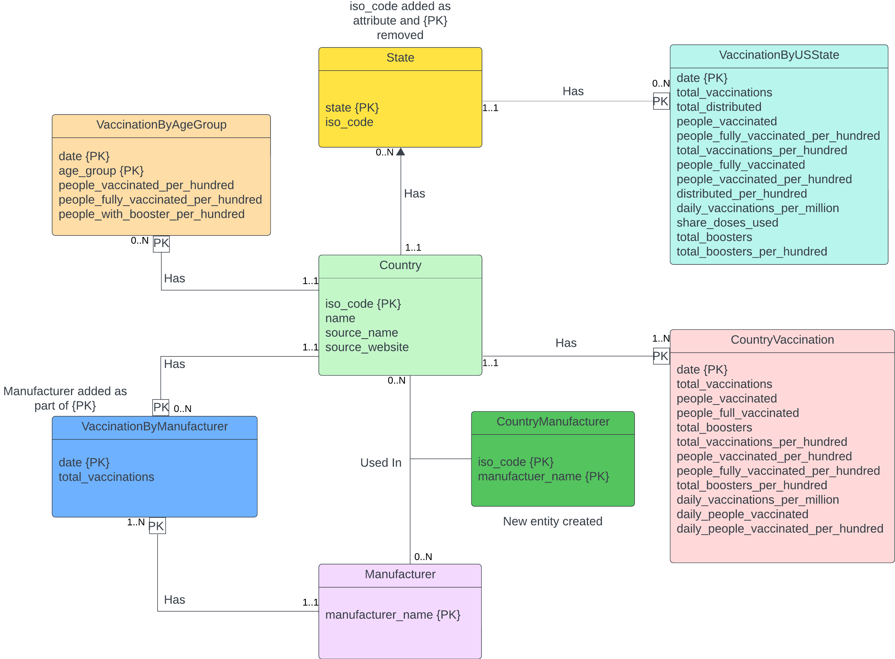

# COVID-19 vaccination database

A normalised relational database built from Our World in Data's global COVID-19 vaccination dataset, with the schema, the populated SQLite database and a set of report queries.

Completed in 2024 during my Master of Data Science at RMIT University.

## Data

Source: [Our World in Data COVID-19 vaccination dataset](https://github.com/owid/covid-19-data/tree/master/public/data/vaccinations) (Mathieu et al., 2021, *Nature Human Behaviour*), published under a CC BY licence.

The source is a set of CSV files that overlap and are not structured for a relational database: country-level daily observations, a locations file listing the vaccines each country uses, vaccinations by manufacturer, vaccinations by age group, United States state-level data, and separate per-country files.

## Design



The main design decisions:

- **One list of countries.** The locations file did not contain every location that appears in the vaccination data, so all locations were combined into a single `Country` table keyed on ISO code.
- **Countries only.** The source mixes countries with aggregates such as continents, the European Union and income groups. Aggregates were removed so that every row in `Country` is a country.
- **Multivalued vaccine list split out.** The locations file stores each country's vaccines as a comma-separated list. This became a `Manufacturer` table plus a `CountryManufacturer` linking table, giving one row per country and manufacturer.
- **"Vaccines" renamed to manufacturers.** The source column lists manufacturers, each of which produced several vaccine formulations, so the entity is named for what it holds.
- **Redundant columns dropped.** Daily vaccination counts are derived from the change in cumulative totals, and the last-observation date can be read from the observations themselves. Per-hundred and per-million columns were kept because population is not in the dataset, so they cannot be recalculated.
- **Per-country files omitted.** The separate files for Wales, Canada, the United States and Denmark repeat data already held in the main table.
- **United States states separated.** State-level observations sit in their own table, linked through a `State` table. Records in the state file that are not states were removed.

The result is eight tables with primary and foreign keys throughout:

| Table | Rows |
|---|---|
| Country | 223 |
| Manufacturer | 29 |
| CountryManufacturer | 957 |
| CountryVaccination | 179,193 |
| VaccinationByManufacturer | 54,919 |
| VaccinationByAgeGroup | 72,677 |
| State | 65 |
| VaccinationByUSState | 54,628 |

Country observations run from December 2020 to May 2024.

## Data quality fixes

Testing the queries against the populated database exposed two problems with the original import, both now corrected:

- **Missing values stored as empty strings.** Over 1.2 million blank cells had been imported as empty text, not `NULL`. SQLite then treated them as numbers in some comparisons and text in others, so totals came back blank or out of order. All were converted to `NULL`.
- **Inconsistent date formats.** Three tables held dates as day/month/year text (for example `9/7/2021`), which SQLite cannot sort or filter as dates. All dates are now stored as `YYYY-MM-DD`, and were checked against the source files.

The schema also had a misspelt column name and one percentage column declared as an integer. Both are fixed, and the database was rebuilt from the corrected `schema.sql` with every row count and foreign key checked.

## Files

- `schema.sql`: table definitions and constraints
- `data/vaccinations.db`: the populated SQLite database (about 29 MB)
- `queries.sql`: five report queries
- `er_model.png`: the entity-relationship model

## Queries

`queries.sql` contains five reports:

1. Cumulative doses administered per country at the end of two months, and the difference between them
2. Countries whose cumulative doses were above that month's average
3. Vaccine manufacturers and the countries using each
4. Total doses administered per country, with the data source for each
5. People fully vaccinated at the end of each month in 2022 and 2023 for the United States, Wales, Canada and Denmark

The vaccination figures are running totals reported on irregular dates, so every monthly figure uses the last value a country reported in that month. The queries use common table expressions and window functions (`ROW_NUMBER`), so they need SQLite 3.25 or later.

## Running it

Open `data/vaccinations.db` in [DB Browser for SQLite](https://sqlitebrowser.org) or SQLiteStudio and run any query from `queries.sql`. From a terminal:

```
sqlite3 data/vaccinations.db < queries.sql
```

To rebuild from scratch, run `schema.sql` against an empty database and import the source CSVs after restructuring them to match the tables.
